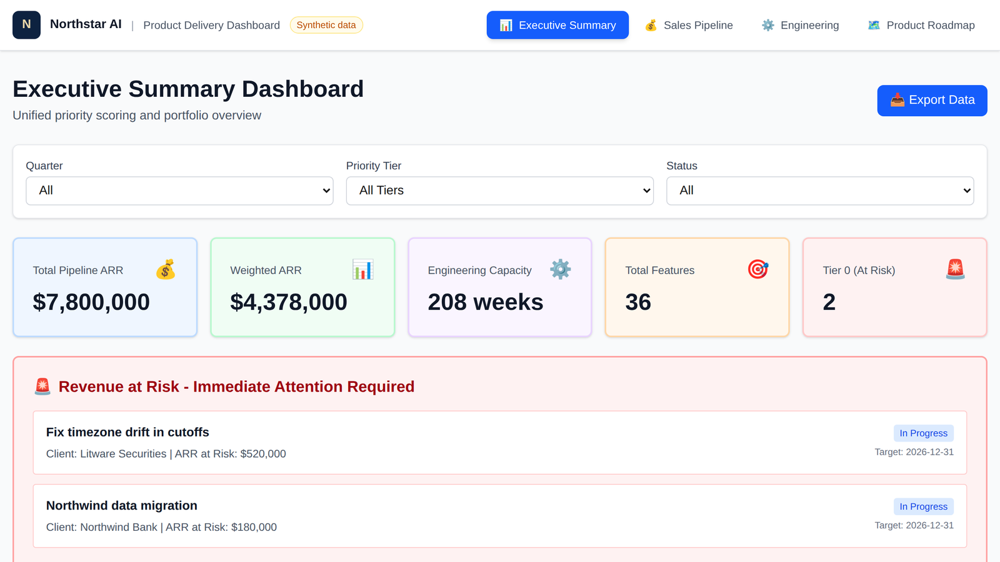
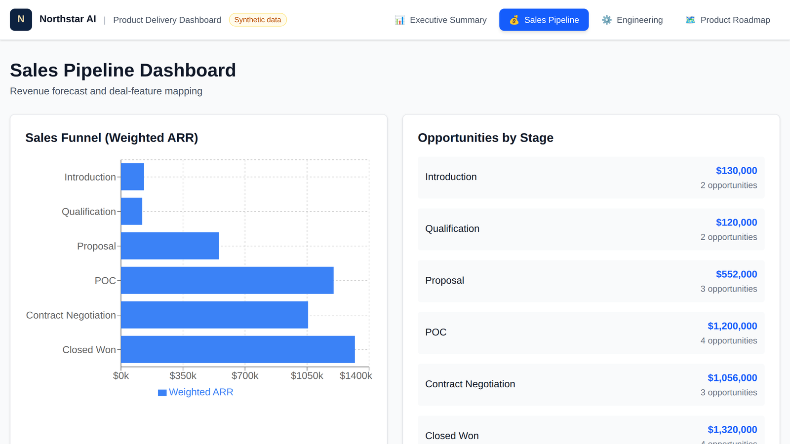
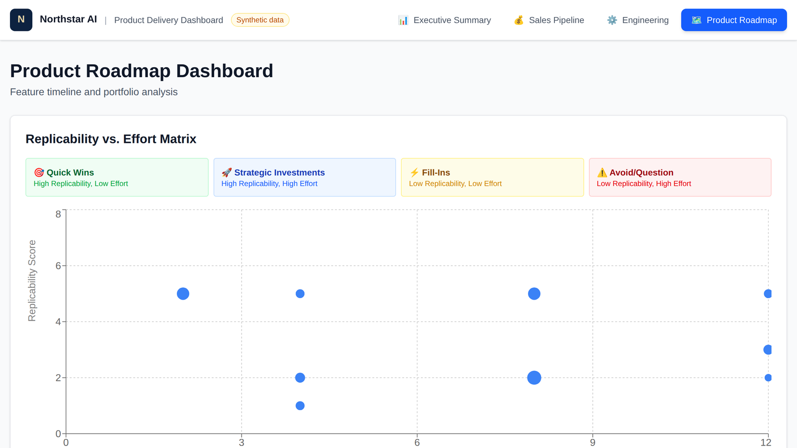

# Product Delivery Dashboard

**One page that answers "where are we?" for the CPO, engineering and sales, without a weekly status meeting.**

[Live demo](https://gabbyignacio7.github.io/product-delivery-dashboard/) · Synthetic data



## The problem

At a growing software company the status of the roadmap lives in three places. Engineering tracks work in Jira. Sales tracks deals in a CRM. Product keeps the priorities in a spreadsheet. Every week someone rebuilds the picture by hand: which features are late, which deals depend on them, where engineering time is going, and what is putting revenue at risk. By the time the deck is done, it is out of date.

## What it does

Four views read the same three data sources, plus a detail page for every feature:

| View | Answers |
|---|---|
| **Executive Summary** | Pipeline and weighted ARR, engineering weeks committed, features by priority tier, and a red panel for anything putting revenue at risk. Filter by quarter, tier and status, and export to CSV. |
| **Sales Pipeline** | Weighted ARR by stage, and which features each open deal is waiting on. |
| **Engineering** | Backlog, in-progress and not-started effort, blocked tickets, and story points by type of work. |
| **Product Roadmap** | Features by quarter with progress, a replicability vs. effort matrix, and effort and ARR by product line. |
| **Feature detail** | Financials, effort, owner, linked tickets and linked deals for one feature. |

Every feature gets a priority score: expected ARR, weighted by win probability and by how many clients can reuse the work, divided by the weeks it takes to build. Scores sort into tiers, from Tier 0 (revenue at risk, act now) to Tier 4 (backlog). That turns the "what do we build next" debate into a ranked list everyone can see and argue with.





## How it's built

- Next.js with TypeScript and Tailwind, exported as a static site and deployed to GitHub Pages by a GitHub Actions workflow.
- Recharts for the charts. No backend: the app reads three JSON files at load time (`features`, `jira`, `sales`), so any source that can write those files can feed it.
- `scripts/generate_data.py` produces the synthetic data set in this repo: 36 features, 166 tickets and 18 opportunities for a fictional company, Northstar AI.

## What I owned

As Technical PM at an AI software company, I built the original version of this dashboard. Browser agents pulled data from Jira and Monday.com across 9 data domains, which replaced manual weekly status reporting for the CPO, engineering and sales.

## Run it

```bash
git clone https://github.com/gabbyignacio7/product-delivery-dashboard.git
cd product-delivery-dashboard
npm install
npm run dev                                   # http://localhost:3000
python3 scripts/generate_data.py public/data  # regenerate the sample data
npm run build                                 # static export to ./out
```

## About this repo

This is a portfolio rebuild of work I did for an employer. Every company, client, person, deal and ticket in it is invented, and no client or employer data is included.

**Stack:** Next.js, React, TypeScript, Tailwind CSS, Recharts, GitHub Actions, GitHub Pages.

Shared as a portfolio piece. All rights reserved.

Built by [Gabriel Ignacio](https://7thfloorventures.com), 7th Floor Ventures.
